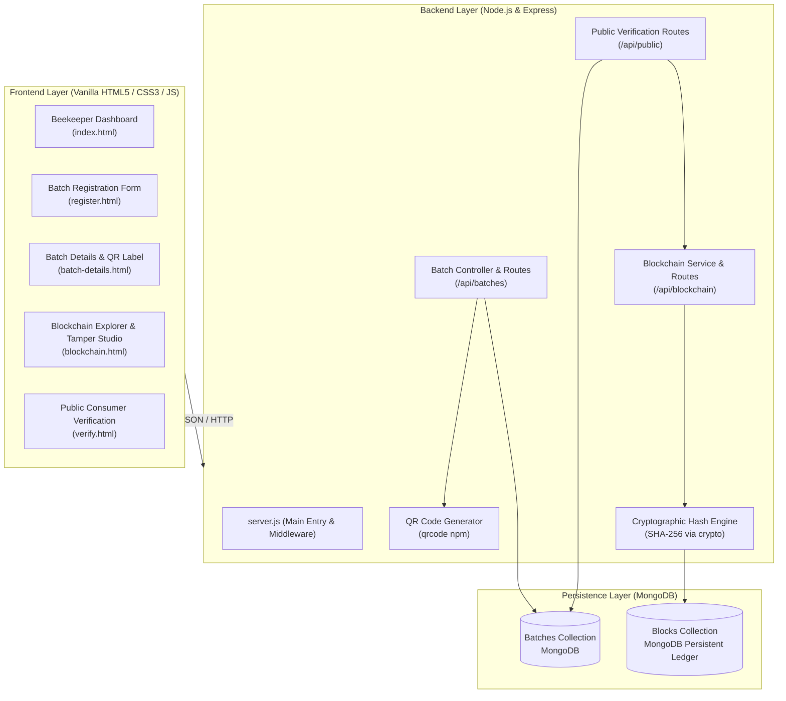

# 🍯 Honey Chain — Blockchain-Based Honey Traceability and Smart Beekeeping Management

[](https://nodejs.org/)
[](https://expressjs.com/)
[](https://www.mongodb.com/)
[](https://nodejs.org/api/crypto.html)
[](LICENSE)

An academic prototype and minimal viable product (MVP) developed for college Design Thinking & Innovation (DTI) / Final-Year Practical Examination and Research. Honey Chain demonstrates end-to-end honey traceability, quality status tracking, QR-code consumer verification, and a tamper-evident cryptographic blockchain ledger.

---

## 📑 Table of Contents

1. [Project Overview](#1-project-overview)
2. [Architecture Explanation](#2-architecture-explanation)
3. [Folder Structure](#3-folder-structure)
4. [Prerequisites & Environment Configuration](#4-prerequisites--environment-configuration)
5. [Startup Instructions](#5-startup-instructions)
6. [Implemented Features & Limitations](#6-implemented-features--limitations)
7. [API Endpoint Documentation](#7-api-endpoint-documentation)
8. [Automated Test Suite & Test Results](#8-automated-test-suite--test-results)
9. [Step-by-Step ESE Practical Viva Demonstration Script](#9-step-by-step-ese-practical-viva-demonstration-script)
10. [Critical Viva Concept: The "Oracle Problem" in Traceability](#10-critical-viva-concept-the-oracle-problem-in-traceability)
11. [Future Extensions for Final-Year Project & Research Paper](#11-future-extensions-for-final-year-project--research-paper)
12. [Troubleshooting](#12-troubleshooting)

---

## 1. Project Overview

Honey adulteration (with high-fructose corn syrup, sugar cane syrup, and synthetic sweeteners) is a major global food fraud issue. Traditional paper logs and centralized databases can easily be manipulated without detection.

**Honey Chain** addresses this problem by anchoring every physical harvest event and quality-testing certification onto a cryptographic, hash-linked ledger. Any post-facto modification of historical records immediately breaks the cryptographic chain and triggers an alert.

### Key Objectives:
- Provide beekeepers with a clean dashboard to record harvests and track yields.
- Automatically anchor every event as a cryptographically linked SHA-256 block.
- Generate batch QR codes for honey jars that direct consumers to a public verification page.
- Distinguish between application records, cryptographic immutability, and physical purity.

---

## 2. Architecture Explanation

Honey Chain follows a modular, monolithic MVC architecture with zero frontend framework dependencies (Vanilla JavaScript, HTML5, CSS3), an Express REST API backend, and MongoDB persistent storage.



### Cryptographic Block Structure:
Each block in the ledger contains:
- `index`: Sequential integer (0 for Genesis, 1, 2, 3...)
- `timestamp`: Milliseconds since epoch
- `batchId`: Batch identifier (e.g. `HC-2026-XXXX`) or `GENESIS`
- `event`: Event type (`GENESIS`, `BATCH_REGISTERED`, `QUALITY_STATUS_UPDATED`)
- `data`: Canonicalized JSON payload containing the event parameters
- `previousHash`: The SHA-256 hash of the immediately preceding block
- `hash`: `SHA256(index + timestamp + batchId + event + canonicalData + previousHash)`

---

## 3. Folder Structure

```
honey-chain/
├── .env.example               # Template for environment configuration
├── .env                       # Active local environment variables
├── .gitignore                 # Files excluded from git tracking
├── package.json               # Dependencies and npm run scripts
├── README.md                  # Comprehensive technical documentation
├── server.js                  # Express application entry point
├── config/
│   └── db.js                  # MongoDB Mongoose connection handler
├── models/
│   ├── Batch.js               # Mongoose schema for Honey Batch documents
│   └── Block.js               # Mongoose schema for Blockchain Blocks
├── services/
│   ├── blockchain.js          # Core SHA-256 cryptographic chain logic & validation
│   ├── stockService.js        # Dynamic 10-year age boundary classification logic
│   └── sampleBatches.js       # 12 realistic demonstration batches (2012-2026)
├── routes/
│   ├── batchRoutes.js         # Honey batch CRUD, stock partitioning & history updates
│   ├── blockchainRoutes.js    # Chain verification & controlled tamper endpoints
│   └── publicRoutes.js        # Public-safe verification for QR code scans
├── public/
│   ├── index.html             # Beekeeper Dashboard with Stock Inventory Overview
│   ├── stock.html             # Two-Column Honey Stock Page (Old Stock vs. New Stock)
│   ├── register.html          # Batch Registration Form (with Variety & Reserve Name)
│   ├── batch-details.html     # Batch Details, QR label display, download & print
│   ├── blockchain.html        # Chain integrity dashboard & Viva Tamper Studio
│   ├── verify.html            # Public Consumer verification certificate
│   ├── css/
│   │   └── style.css          # Honey-gold/cream accessible theme & responsive stock grid
│   └── js/
│       ├── api.js             # Shared fetch utilities & toast notifications
│       ├── dashboard.js       # Dashboard logic & batch directory
│       ├── stock.js           # Honey Stock two-column dynamic renderer & filters
│       ├── register.js        # Form validation & registration submission
│       ├── batch-details.js   # QR display, status update modal & timeline
│       ├── blockchain.js      # Ledger explorer & tamper simulator
│       └── verify.js          # Public verification certificate & 3-pillar banner
└── test/
    ├── blockchain.test.js     # Blockchain unit tests (hashing, tamper detection)
    ├── stockClassification.test.js # 10-year boundary & dynamic age unit tests
    └── e2e.test.js            # Complete 11-point end-to-end integration test
```

---

## 4. Prerequisites & Environment Configuration

### Prerequisites:
1. **Node.js** (v18.0.0 or higher recommended, verified on v24.13.0).
2. **MongoDB** (Local instance running on port 27017 or a MongoDB Atlas URI).
3. **Web Browser** (Chrome, Firefox, Edge, Safari).

### Environment Configuration:
Copy `.env.example` to `.env`:
```bash
cp .env.example .env
```

Default contents of `.env`:
```env
PORT=3000
MONGODB_URI=mongodb://127.0.0.1:27017/honeychain
APP_BASE_URL=http://localhost:3000
NODE_ENV=development
```

> **Note on Mobile QR Testing:** If demonstrating by scanning the QR code with a physical smartphone, replace `localhost:3000` with your computer's local Wi-Fi IP address (e.g., `APP_BASE_URL=http://192.168.1.15:3000`).

---

## 5. Startup Instructions

### 1. Install Dependencies
```bash
npm install
```

### 2. Ensure MongoDB is Running
If running MongoDB locally via command line:
```bash
# Example for Windows:
mongod --dbpath ./data/db --port 27017
```

### 3. Start the Server
```bash
npm start
```
*The server will initialize the Genesis Block in MongoDB and bind to port 3000.*

### 4. Access the Application:
- **Beekeeper Dashboard:** [http://localhost:3000](http://localhost:3000)
- **Honey Stock Classification:** [http://localhost:3000/stock.html](http://localhost:3000/stock.html)
- **Batch Registration:** [http://localhost:3000/register.html](http://localhost:3000/register.html)
- **Blockchain Ledger Explorer:** [http://localhost:3000/blockchain.html](http://localhost:3000/blockchain.html)
- **Public Consumer Verification:** [http://localhost:3000/verify.html](http://localhost:3000/verify.html)

---

## 6. Implemented Features & Limitations

### Implemented Features:
1. **Beekeeper Dashboard:** Real-time metrics for total batches, harvested quantity (kg), certified tests, dynamic stock overview, and live ledger integrity status.
2. **Honey Stock Classification (Old vs. New Stock):** Dedicated two-column responsive view dividing inventory dynamically:
   - **Old Stock:** Honey batches harvested more than 10 years ago.
   - **New Stock:** Honey batches harvested 10 years ago or less.
   - Automatically migrates batches from New Stock to Old Stock as time advances without manual database updates.
3. **12 Realistic Demonstration Batches:** Spans 2012–2026 across botanical varieties (Multiflora, Eucalyptus, Forest Honey, Acacia, Wildflower, Clover, Lavender, Orange Blossom, Manuka), each anchored to the blockchain ledger and clearly labeled as fictional demo data.
4. **Strict Server-Side Validation:** Ensures harvest dates are not in the future, extraction date is on or after harvest date, and quantity is greater than 0 kg.
5. **Persistent Hash-Linked Ledger:** Every batch creation and quality status change generates a SHA-256 block stored persistently in MongoDB.
6. **QR Code Generator:** Automatically creates a high-contrast QR code pointing to the public consumer verification page. Supports instant PNG download and jar label printing.
7. **Consumer Verification Certificate:** A dedicated public page designed for honey consumers scanning a jar QR code.
8. **Controlled Tamper Demonstration Studio:** An interactive module that directly modifies a block's MongoDB payload without recalculating its hash, proving to examiners that cryptographic verification detects unauthorized changes.
9. **Automated Test Suite:** Includes automated unit tests (blockchain, stock classification) and an 11-step end-to-end integration test.

### Academic Limitations (Viva Transparency):
- **Single-Node Prototype vs Decentralization:** This MVP is a *local cryptographic ledger*. It uses SHA-256 parent-child hashing identical to a blockchain, but is stored in MongoDB rather than distributed across thousands of peer-to-peer nodes with Proof-of-Work or Proof-of-Stake consensus.
- **Authentication & Roles:** For practical examination simplicity, user authentication (JWT/OAuth) is omitted. Endpoints are conceptually separated into Beekeeper operations and Public consumer operations.
- **The "Oracle Problem":** Cryptographic verification guarantees data integrity within the database. It cannot independently verify physical honey purity without certified laboratory tests.

---

## 7. API Endpoint Documentation

| Method | Endpoint | Access | Description |
|---|---|---|---|
| `GET` | `/api/health` | Public | Server uptime and health check |
| `GET` | `/api/batches` | Beekeeper | List all batches with aggregate statistics & age metadata |
| `GET` | `/api/batches/stock` | Beekeeper/Public | Partition batches into Old Stock (>10 yrs) and New Stock (≤10 yrs) |
| `POST` | `/api/batches/seed-samples` | Beekeeper/Demo | Seed 12 demonstration batches spanning 2012–2026 anchored to ledger |
| `POST` | `/api/batches` | Beekeeper | Register batch, validate inputs, persist, and anchor Block 1 |
| `GET` | `/api/batches/:batchId` | Beekeeper | Get batch details, QR Code Data URL, stock age, and history |
| `PATCH`| `/api/batches/:batchId/status` | Beekeeper | Update status (Pending/Passed/Failed) & anchor new Block |
| `POST` | `/api/batches/:batchId/event` | Beekeeper | Add lifecycle event (Packaging/Distribution) & anchor Block |
| `GET` | `/api/blockchain` | Public | Return all blocks and chain validation status |
| `GET` | `/api/blockchain/validate` | Public | Run full cryptographic verification across all blocks |
| `GET` | `/api/blockchain/history/:batchId` | Public | Fetch chronological blockchain audit blocks for a batch |
| `POST` | `/api/blockchain/tamper` | Demo | Viva tool: modify MongoDB data directly to test detection |
| `POST` | `/api/blockchain/restore` | Demo | Viva tool: restore tampered block to original pristine state |
| `GET` | `/api/public/verify/:batchId` | Consumer | Public-safe certificate data with 3-pillar disclaimer |
| `POST` | `/api/blockchain/restore` | Demo | Viva tool: restore tampered block to original pristine state |
| `GET` | `/api/public/verify/:batchId` | Consumer | Public-safe certificate data with 3-pillar disclaimer |

---

## 8. Automated Test Suite & Test Results

Run all automated unit tests:
```bash
node test/blockchain.test.js
```

Run complete end-to-end integration tests:
```bash
node test/e2e.test.js
```

### Verified Test Results Summary:
```text
====================================================
   HONEY CHAIN — COMPLETE END-TO-END TEST SUITE     
====================================================

[Database] MongoDB connected successfully: 127.0.0.1/honeychain
[Blockchain] Genesis Block successfully initialized with hash: 9ab6a712f6...
[Test Server] Live on http://127.0.0.1:3456

[Test 1] GET /api/health
  ✔ Health check passed

[Test 2] POST /api/batches with invalid payload
  ✔ Invalid batch registration correctly rejected with 400 Bad Request

[Test 3] POST /api/batches with valid batch data
  ✔ Batch created with ID: HC-2026-2888
  ✔ Anchored in Blockchain Block #1
  ✔ Block Hash: c54fffc71acc389c6784dc5a1438d2f825908fc97d41d7ed961aba830b1beeea

[Test 4] GET /api/batches
  ✔ Batches retrieved successfully. Total batches: 1, Total yield: 52.4 kg

[Test 5] GET /api/batches/HC-2026-2888
  ✔ Batch details retrieved
  ✔ QR code generated successfully (Base64 PNG verified)

[Test 6] PATCH /api/batches/HC-2026-2888/status (Pending -> Passed)
  ✔ Batch quality status updated to Passed
  ✔ Appended to new Block #2

[Test 7] GET /api/blockchain/validate
  ✔ Blockchain verified intact! Total blocks in chain: 3

[Test 8] GET /api/public/verify/HC-2026-2888
  ✔ Public consumer verification page data retrieved
  ✔ Educational disclaimer three pillars confirmed present

[Test 9] POST /api/blockchain/tamper (Simulating database hack on Block #1)
  ✔ Data tampered in database without re-hashing
  ✔ TAMPERING SUCCESSFULLY CAUGHT!
    Reason: Tampering detected at Block #1! Stored hash does not match computed SHA-256 hash.

[Test 10] POST /api/blockchain/restore (Restoring Block #1)
  ✔ Block restored! Chain verification back to 100% valid.

====================================================
   ALL 10 END-TO-END TESTS PASSED WITH 100% SUCCESS!  
====================================================
```

---

## 9. Step-by-Step ESE Practical Viva Demonstration Script

Follow this script during your practical examination viva:

### Step 1: Launch Application & Verify Architecture
1. Open terminal: `npm start`.
2. Point out to the examiner: *"The server connected to MongoDB and automatically verified the Genesis Block root (Block #0) with previousHash as 64 zeroes."*
3. Open browser to `http://localhost:3000`. Show the Beekeeper Dashboard with aggregate metrics and the green **Cryptographic Ledger: 100% Intact** banner.

### Step 2: Register a Honey Batch
1. Click **Register New Batch**.
2. First show validation: Enter a negative quantity `-5` or an extraction date earlier than harvest date. Show the examiner that the system strictly prevents invalid entries.
3. Enter realistic harvest values:
   - Beekeeper: `Dr. Ronald Vance`
   - Apiary: `Pine Valley Apiary, Plot 4`
   - Hive ID: `HIVE-08-ALPHA`
   - Harvest Date: *Today*
   - Extraction Date: *Today*
   - Quantity: `45.5` kg
   - Quality Status: `Pending Laboratory Analysis`
   - Notes: `Wildflower & Clover blend, moisture 17.2%`
4. Click **Save & Anchor on Blockchain**.
5. Show the modal: Highlight that an immutable **Block #1** was created and assigned a cryptographic SHA-256 hash.

### Step 3: Inspect Batch Details & QR Code
1. Click **View Batch & QR Code**.
2. Point out the auto-generated high-resolution QR code.
3. Show the **Download QR Code (PNG)** button and **Print Jar Label** button.
4. Show the chronological **Blockchain Audit Trail** at the bottom, showing Block #1 with its previous hash and block hash.

### Step 4: Update Quality Status & Show Immutability
1. Click **Update Quality Status**.
2. Change status to **Passed** and enter notes: `Certified Pure: Pollen analysis 98.2%, Moisture 16.5%`.
3. Click **Append Block & Update**.
4. Show the examiner that instead of silently overwriting historical data, a new **Block #2** has been added to the audit trail.

### Step 5: Consumer Verification via QR Code
1. Click **Open Consumer Page** (or scan QR code with phone if LAN IP is configured).
2. Show the **Digital Certificate of Origin & Traceability**.
3. Point out the live **Cryptographic Integrity Verified** banner.

### Step 6: The Controlled Tamper Demonstration (Crucial Viva Moment!)
1. Navigate to **Blockchain Ledger** ([http://localhost:3000/blockchain.html](http://localhost:3000/blockchain.html)).
2. Show the complete block explorer: Block #0 (Genesis), Block #1 (Batch Registered), Block #2 (Quality Updated). Show how each block's `previousHash` matches the prior block's hash.
3. Scroll to the **Controlled Viva Tampering Demonstration Studio**.
4. Select **Block #1**, field **quantityKg**, and set malicious value `999.9` (simulating an attacker attempting to inflate honey volume).
5. Click **Simulate Malicious Tamper**.
6. **Watch the screen turn RED!**
   - The status changes to: `🔴 TAMPERING DETECTED AT BLOCK #1`.
   - Show the examiner the exact reason: *The computed SHA-256 hash of the modified data no longer matches the stored cryptographic hash!*
7. Open the Consumer Verification page for that batch: it now shows `⚠ INTEGRITY ALERT: Ledger record compromised!`.
8. Return to the Blockchain page and click **Restore Original Block**.
9. The chain immediately returns to green `✔ 100% INTACT`.

---

## 10. Critical Viva Concept: The "Oracle Problem" in Traceability

When examiners ask: *"Does storing a honey batch on a blockchain guarantee that the honey in the jar is 100% pure?"*

### Your Viva Answer:
> *"No, sir/ma'am. That represents the classic **'Oracle Problem'** or 'Garbage-In, Garbage-Out' principle of blockchain systems.*
>
> *A blockchain provides **cryptographic immutability of the digital record**—meaning once beekeeper and lab data are entered, nobody can retroactively alter or forge that history without detection.*
>
> *However, digital cryptography alone cannot prove physical honey purity in the jar unless paired with:
> 1. Accredited third-party laboratory chemical analysis (pollen microscopy, C4 sugar isotope analysis).
> 2. Tamper-evident physical jar packaging seals linking the physical jar to the digital Batch ID.*
>
> *Our application explicitly educates consumers on this distinction through the Three-Pillar Certificate section."*

---

## 11. Future Extensions for Final-Year Project & Research Paper

1. **IoT Smart Hive Integration:** Connect ESP32/Arduino microcontroller sensors to measure hive internal temperature, humidity, and frame acoustic frequencies (swarming prediction), automatically anchoring periodic hive health digests onto the blockchain.
2. **AI Colony Health & Pest Detection:** Train a YOLOv8 computer vision model to detect *Varroa destructor* mite infestations on honeycomb images captured by hive cameras.
3. **Decentralized Multi-Node Consensus:** Transition from MongoDB single-node prototype to a permissioned blockchain (e.g. Hyperledger Fabric or Ethereum Polygon testnet) using smart contracts for supply-chain custody handoffs.
4. **Decentralized Storage (IPFS):** Store laboratory PDF test certificates and pollen chromatography graphs on IPFS (InterPlanetary File System), storing only the IPFS cryptographic CID hash on the block.
5. **Role-Based Access Control (RBAC):** Implement cryptographically signed transactions using beekeeper and laboratory asymmetric private/public keys (ECDSA).

---

## 12. Troubleshooting

| Issue | Cause | Solution |
|---|---|---|
| `MongoServerError: connect ECONNREFUSED 127.0.0.1:27017` | MongoDB server process is not running. | Run `mongod --dbpath ./data/db --port 27017` or start the MongoDB service. |
| `EACCES: permission denied` on port 3000 | Port 3000 is occupied by another application. | Change `PORT=3001` in `.env` and restart. |
| QR Code scan doesn't open on phone | Phone cannot reach `localhost` of your computer. | Set `APP_BASE_URL=http://<YOUR_LOCAL_IP>:3000` in `.env` (e.g. `http://192.168.1.42:3000`). |
| Blockchain shows red alert immediately | Previous demo tampering was not restored. | Go to `blockchain.html` and click **Restore Original Block**, or run `npm test`. |

---
*Honey Chain — College DTI & Academic Project MVP*
